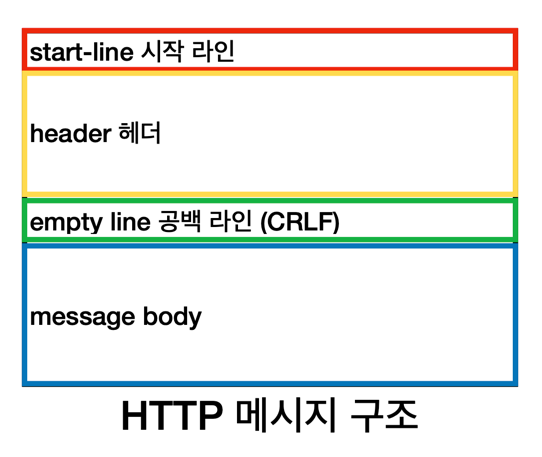

## 섹션 4. HTTP 기본

### 11. 모든 것이 HTTP
HTTP  
HyperText Transfer Protocol

HTTP 메시지에 모든 것을 전송
- HTML, TEXT
- IMAGE, 음성, 영상, 파일
- JSON, XML (API)
- 거의 모든 형태의 데이터 전송 가능
- 서버간에 데이터를 주고 받을 때도 대부분 HTTP 사용

기반 프로토콜
- TCP: HTTP/1.1, HTTP/2
- UDP: HTTP/3
- 현재 HTTP/1.1 주로 사용
  - HTTP/2, HTTP/3 도 점점 증가

HTTP 특징
- 클라이언트 서버 구조
- 무상태 프로토콜(stateless), 비연결성
- HTTP 메시지
- 단순함, 확장 가능

### 12. 클라이언트 서버 구조
클라이언트 서버 구조
- Request - Response 구조
- 클라이언트는 서버에 요청을 보내고, 응답을 대기
- 서버가 요청에 대한 결과를 만들어서 응답

### 13. Stateful, Stateless
무상태 프로토콜
Stateless
- 서버가 클라이언트의 상태를 보존하지 않음
- 장점: 서버 확장성 높음 (스케일 아웃: 수평 확장)
- 단점: 클라이언트가 추가 데이터 전송

상태 유지 - Stateful - 항상 같은 서버가 유지되어야 함  
무상태 - Stateless - 아무 서버나 호출해도 됨

Stateful, Stateless 차이
- 상태 유지: 중간에 다른 점원으로 바뀌면 안됨 (중간에 다른 점원으로 바뀔 때 상태 정보를 다른 점원에게 미리 알려줘야 함)
- 무상태: 중간에 다른 점원으로 바뀌어도 됨
  - 갑자기 고객이 증가해도 점원을 대거 투입할 수 있음
  - 갑자기 클라이언트 요청이 증가해도 서버를 대거 투입할 수 있음
- 무상태는 응답 서버를 쉽게 바꿀 수 있음 => 무한한 서버 증설 가능

Stateless 한계
- 모든 것을 무상태로 설계 할 수 있는 경우도 있고, 없는 경우도 있음
- 무상태
  - ex) 로그인 필요 없는 단순한 서비스 소개 화면
- 상태 유지
  - ex) 로그인
- 로그인한 사용자의 경우 로그인 했다는 상태를 서버에 유지
- 일반적으로 브라우저 쿠키와 서버 세션등을 사용해서 상태 유지
- 상태 유지는 최소한만 사용
- 상태를 알리기 위한 정보(데이터)가 많이 필요한 단점

### 14. 비 연결성(connectionless)
비 연결성
- HTTP는 기본이 연결을 유지하지 않는 모델 
- 일반적으로 초 단위 이하의 빠른 속도로 응답
- 1시간 동안 수천명이 서비스를 사용해도 실제 서버에서 동시에 처리하는 요청은 수십개 이하로 매우 작음
  - ex) 웹 브라우저에서 계속 연속해서 검색 버튼을 누르지 않음
- 서버 자원을 매우 효율적으로 사용할 수 있음

한계와 극복
- TCP/IP 연결을 새로 맺어야 함 - 3 way handshake 시간 추가
- 웹 브라우저로 사이트 요청하면 HTML 뿐만 아니라 자바스크립트, css, 추가 이미지 등 수많은 자원이 함께 다운로드
- 지금은 HTTP 지속 연결(Persistent Connections)로 문제 해결
  - 매 요청마다 연결을 새로 맺는 오버헤드를 줄이기 위해, 한 번 맺은 연결로 여러 요청/응답을 처리하는 지속 연결 사용
- HTTP/2, HTTP/2 에서 더 많은 최적화

### 15. HTTP 메시지

start-line 시작 라인
- 요청 메시지
  - start-line = request-line
  - request-line = method SP(공백) request-target SP(공백) HTTP-version CRLF(엔터)
  - ex) GET /search?q=hello&hl=ko HTTP/1.1
    - HTTP 메서드 (GET: 조회)
      - 종류: GET, POST, PUT, DELETE
      - 서버가 수행해야 할 동작 지정
        - GET: 리소스 조회
        - POST: 요청 내역 처리
    - 요청 대상 (/search?q=hello&hl=ko)
      - 절대경로= "/"로 시작하는 경로
    - HTTP 버전 (HTTP/1.1)
- 응답 메시지
  - start-line = status-line
  - status-line = HTTP-version SP(공백) status-code SP(공백) reason-phrase CRLF(엔터)
  - ex) HTTP/1.1 200 OK
    - HTTP 버전 (HTTP/1.1)
    - HTTP 상태 코드 (200)
      - 요청 성공, 실패 나타냄
        - 200: 성공
        - 400: 클라이언트 요청 오류
        - 500: 서버 내부 오류
    - 이유 문구 (OK)
      - 사람이 이해할 수 있는 짧은 상태 코드 설명 글

header 헤더
- HTTP 전송에 필요한 모든 부가정보가 다 들어있음
- ex) 메시지 바디의 내용, 메시지 바디의 크기, 압축, 인증, 요청 클라이언트(브라우저) 정보, 서버 애플리케이션 정보, 캐시 관리 정보 등
- 표준 헤더가 너무 많음
- 필요시 임의의 헤더 추가 가능

message body 메시지 바디
- 실제 전송할 데이터
- HTML 문서, 이미지, 영상, JSON 등 byte로 표현할 수 있는 모든 데이터 전송 가능
