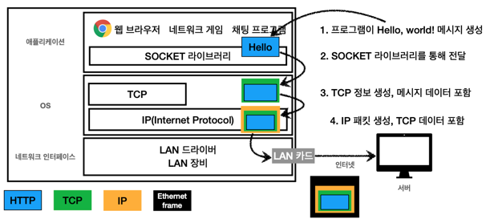
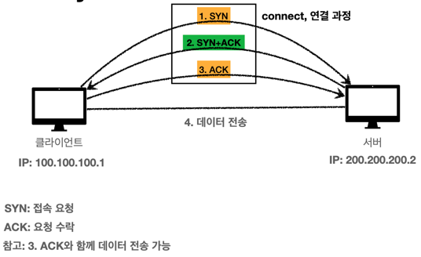

## 섹션 2. 인터넷 네트워크

### 4. 인터넷 통신

### 5. IP(인터넷 프로토콜)
```text
클라이언트 - 인터넷 - 서버
```
- 클라이언트와 서버는 각각 IP를 부여받아야 함

IP: 인터넷 프로토콜 역할
- 지정한 IP 주소 (IP Address)에 데이터 전달
- 패킷(Packet)이라는 통신 단위로 데이터 전달 
  - IP 패킷 정보: 출발지 IP, 목적지 IP, 기타 정보
  - => IP 패킷: IP 패킷 정보 + 전송 데이터

IP 프로토콜의 한계
- 비연결성
  - 패킷을 받을 대상이 없거나 서비스 불능 상태여도 패킷 전송
- 비신뢰성
  - 중간에 패킷이 사라짐
  - 패킷이 순서대로 안옴
- 프로그램 구분
  - 같은 IP를 사용하는 서버에서 통신하는 애플리케이션이 둘 이상인 경우

### 6. TCP, UDP
인터넷 프로토콜 스택 4계층
```text
애플리케이션 계층 - HTTP, FTP
전송 계층 - TCP, UDP
인터넷 계층 - IP
네트워크 인터페이스 계층 
```


TCP/IP 패킷 정보
- IP 패킷 안에 TCP 세그먼트 존재
  - TCP 세그먼트 정보: 출발지 PORT, 목적지 PORT, 전송 제어, 순서, 검증 정보 등
  - => IP 패킷 정보 + TCP 세그먼트 정보 + 전송 데이터

TCP  
전송 제어 프로토콜 (Transmission Control Protocol)

TCP 특징
- 연결지향: 먼저 연결을 성공한 다음 메시지 보냄
  - TCP 3 way handshake (가상 연결)
- 데이터 전달 보증
  - 데이터 잘 전달되었는지 아닌지 확인 가능
- 순서 보장
  - 클라이언트에서 보낸 순서대로 서버에 도착하지 않으면 서버에서 다시 보내라고 재요청함
- 신뢰할 수 있는 프로토콜
- 현재는 대부분 TCP 사용

TCP 3 way handshake  


UDP  
사용자 데이터그램 프로토콜(User Datagram Protocol)

UDP 특징
- 하얀 도화지에 비유 (기능이 거의 없음)
- 연결지향 - TCP 3 way handshake X
- 데이터 전달 보증 X
- 순서 보장 X
- 데이터 전달 및 순서가 보장되지 않지만, 단순하고 빠름
- 정리
  - IP와 거의 같음 (PORT, 체크섬 정도 추가됨)
  - 애플리케이션에서 추가 작업 필요

### PORT
PORT  
같은 IP 내에서 프로세스 구분  

```text
ex) 
클라이언트 IP 100.100.100.1
서버 IP 200.200.200.2 

클라이언트 게임 8090 - 서버 11220  
클라이언트 화상통화 21000 - 서버 32202  
클라이언트 웹 브라우저 10010 - 서버 80
```

- 0 ~ 65535 할당 가능
- 0 ~ 1023: 잘 알려진 포트, 사용하지 않는 것이 좋음
    - FTP - 20, 21
    - TELNET - 23
    - HTTP - 80
    - HTTPS - 443

### DNS
DNS  
도메인 네임 시스템(Domain Name System)

- 전화번호부
- 도메인 명을 IP 주소로 변환

```text
ex)
DNS 서버

도메인 명 | IP
google.com | 200.200.200.2
aaa.com | 210.210.210.3
... | ...
```
